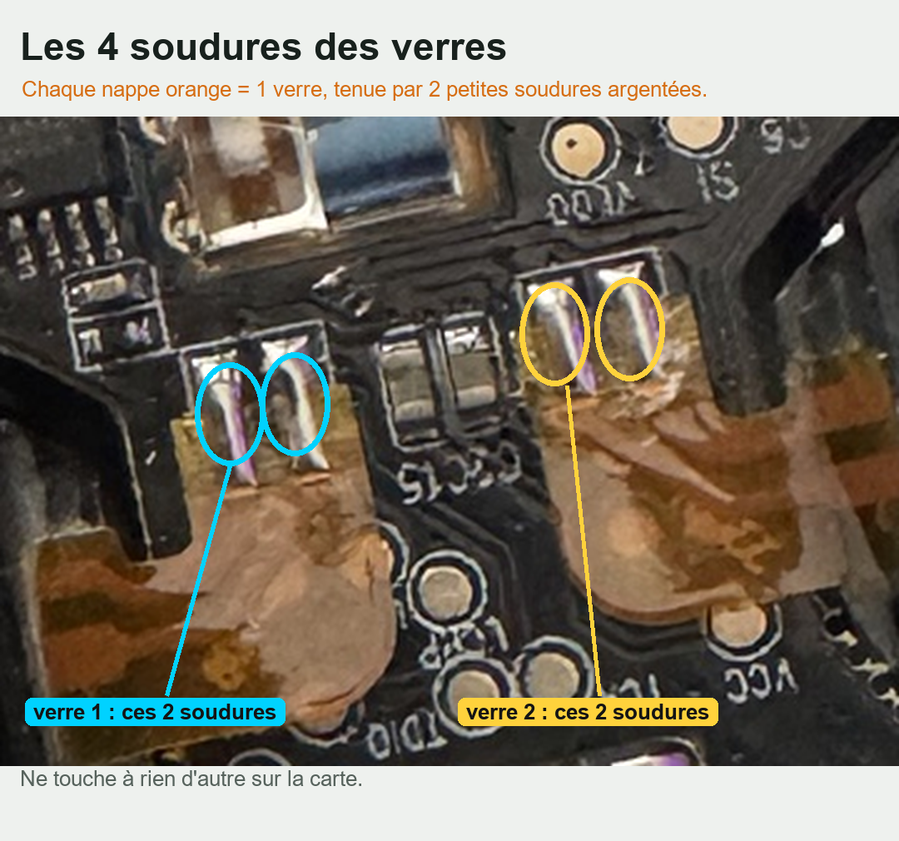
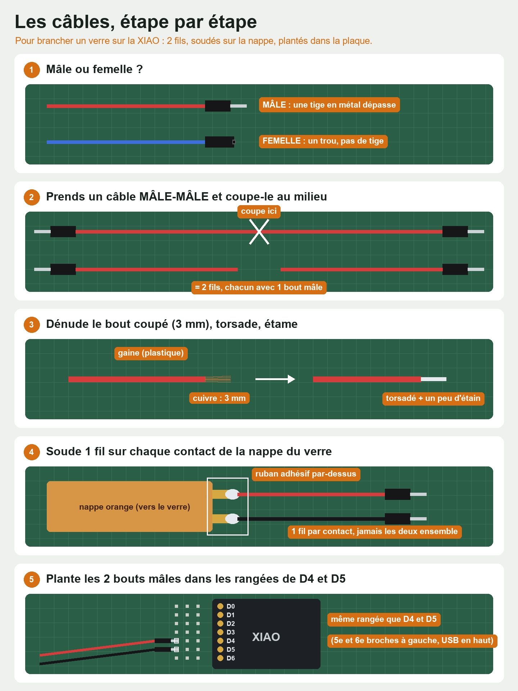
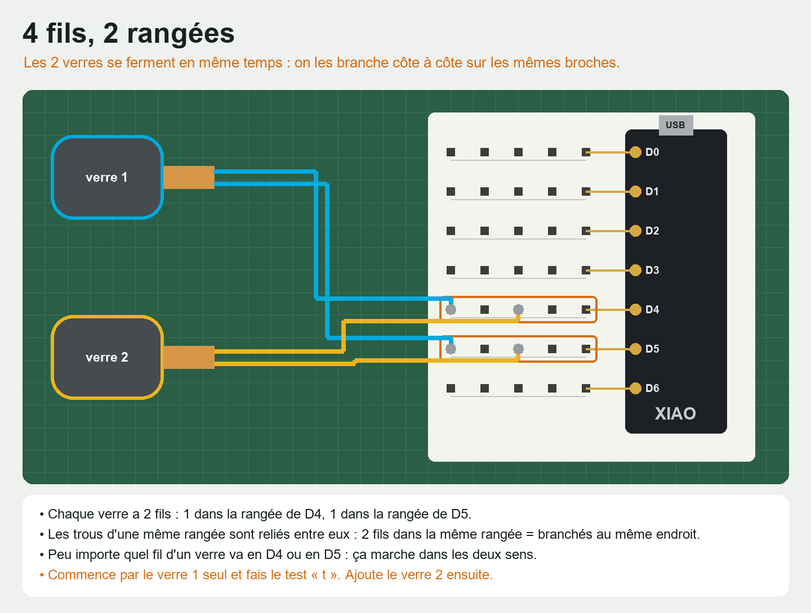
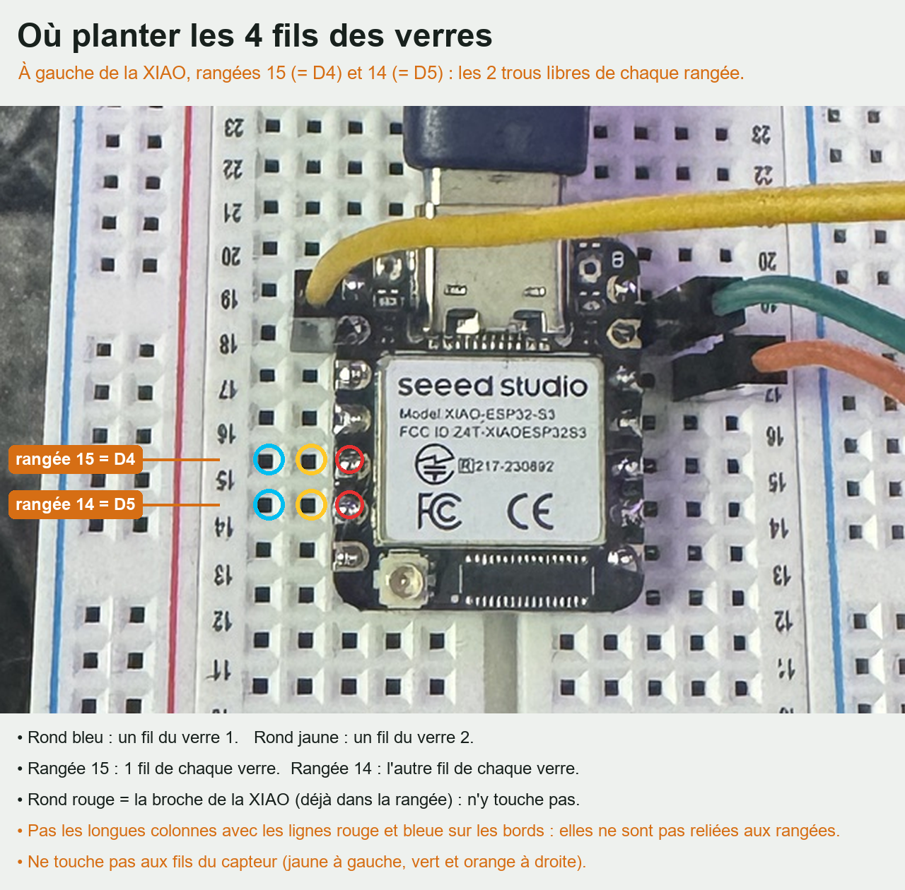

# 🕶️ Moniteur secret : des lunettes pour voir un film que personne d'autre ne voit

Ton écran passe un film… mais à l'œil nu, tout le monde voit juste ton bureau. Seulement à travers **tes lunettes**, le film apparaît.

Inspiré par une vidéo de [Perri Karyal](https://www.instagram.com/perrikaryal/). Ce tuto est indépendant : elle n'y a pas participé, et mon montage peut différer du sien. Il est pensé pour les débutant·es : **tu n'as pas besoin de savoir coder**, tout le code est fourni.

> ⚠️ **Épilepsie** : la démo (touche **M**) fait alterner tout l'écran entre deux images très différentes, **de 1 à 60 fois par seconde**. C'est exactement ce qui peut déclencher une crise. Ne la lance pas et ne la montre pas si toi ou quelqu'un autour est sensible aux lumières qui clignotent.
>
> ⚠️ **Il faut un écran 240 Hz** (144 Hz au strict minimum). Sur un écran 60 Hz, tout l'écran clignote fort : quitte tout de suite avec **Échap**.

---

## Sommaire

- [Comment ça marche](#comment-ça-marche-en-30-secondes)
- [Petit lexique](#petit-lexique)
- [Le matériel](#le-matériel)
- [Partie 1 : le lecteur sur ton PC](#partie-1--le-lecteur-sur-ton-pc)
- [Partie 2 : programmer la carte XIAO](#partie-2--programmer-la-carte-xiao)
- [Partie 3 : ouvrir les lunettes et souder les verres](#partie-3--ouvrir-les-lunettes-et-souder-les-verres)
- [Partie 4 : le test sur plaque d'essai](#partie-4--le-test-sur-plaque-dessai)
- [Partie 5 : tout mettre dans les lunettes](#partie-5--tout-mettre-dans-les-lunettes)
- [Si ça ne marche pas](#si-ça-ne-marche-pas)
- [Filmer pour Instagram / TikTok](#filmer-pour-instagram--tiktok)
- [Sécurité](#sécurité)

---

## Comment ça marche (en 30 secondes)

Un écran 240 Hz affiche **240 images par seconde**. Le programme en profite pour alterner deux images :

- **Image A** = ton écran **+** le film
- **Image B** = ton écran **−** le film (le film « en négatif »)

Elles alternent si vite (120 A et 120 B par seconde) que **ton œil fait la moyenne** : le film et son négatif s'annulent, il ne reste que ton écran.

Les **lunettes 3D actives** ont des verres qui deviennent noirs ou transparents sur commande. On remplace leur électronique par une petite carte (**XIAO ESP32-S3**) et un **capteur de lumière**. Le capteur sent le rythme de l'écran, et la carte ouvre les verres **seulement pendant l'image A**. À travers les lunettes, tu vois donc ton écran + le film : **le film apparaît** (un peu pâle, par-dessus ton écran).

> 💡 Pourquoi ne pas simplement afficher le film une image sur deux ? Parce que l'œil le verrait. C'est l'image B, le négatif, qui l'efface pour les autres. Ce principe s'appelle la *modulation psychovisuelle temporelle*.

---

## Petit lexique

| Mot | Ce que ça veut dire |
|---|---|
| **Hz** | Nombre d'images par seconde que l'écran affiche |
| **XIAO ESP32-S3** | Une carte électronique minuscule qu'on programme : le « cerveau » |
| **Téléverser** | Envoyer le programme de l'ordinateur vers la carte |
| **Moniteur série** | Une fenêtre d'Arduino IDE pour discuter avec la carte (elle y écrit, tu y tapes des commandes) |
| **Port COM** | Le « numéro de prise » USB de ta carte sur l'ordinateur |
| **Broche** (D1, D4, 3V3, GND…) | Les petites pattes de la carte. **3V3** = le +, **GND** = le − |
| **Plaque d'essai** | Une plaque à trous pour brancher sans souder |
| **Câble Dupont** | Petit câble avec un embout à planter (mâle) ou à enfiler (femelle) |
| **Nappe / pastille** | La bande orange souple qui part de chaque verre, et ses petits contacts soudés |
| **Étamer** | Mettre un peu d'étain fondu sur un fil ou une panne avant de souder |
| **Front** | Le moment où la lumière captée remonte : la carte en compte ~120 par seconde |
| **VERROUILLÉ** | La carte a trouvé le rythme de l'écran |
| **µs** | Microseconde, un millionième de seconde |

---

## Le matériel

| Quoi | Pourquoi | Prix indicatif |
|---|---|---|
| **Écran 240 Hz** (idéalement **OLED**) | Indispensable : en dessous, le film scintille et se voit | celui que tu as 🙂 |
| **PC Windows** | Pour le lecteur | — |
| **Un 2ᵉ écran ou un 2ᵉ ordinateur** (un vieux portable suffit) | Pour lire le moniteur série pendant que le film est en plein écran | — |
| **Lunettes 3D actives « DLP-Link »** (moi : XGIMI ; aussi BenQ, génériques) | On garde la monture et les **verres** | 20–35 € |
| **Seeed Studio XIAO ESP32-S3** (version « pre-soldered » si tu ne veux pas souder les broches) | Le cerveau | ~8 € |
| **Capteur de lumière TEMT6000** (petite carte violette) | L'œil qui sent le rythme de l'écran | ~3 € |
| **Plaque d'essai + câbles Dupont mâle-mâle et mâle-femelle** | Pour tester sans souder | ~8 € |
| **Fer à souder + étain + fil fin souple** (silicone 26 AWG) | Pour les verres et le montage final | ~25 € |
| **Petit tournevis cruciforme, pince coupante, ruban adhésif noir, une paille noire** | Ouvrir les lunettes, préparer les fils, le tube du capteur | ~10 € |
| *(partie 5)* **Batterie LiPo 3,7 V, 150 à 300 mAh, AVEC circuit de protection** | Pour des lunettes sans fil | ~6 € |
| *(option)* Module **DRV8833** | Seulement si tes verres restent gris au lieu de noirs | ~3 € |
| *(option)* Multimètre | Vérifier soudures et polarité | ~10 € |

Logiciels gratuits : **Python 3.12 ou 3.13** et **Arduino IDE 2**.

---

## Partie 1 : le lecteur sur ton PC

On commence par voir l'effet sur ton écran, sans électronique.

### Régler Windows et l'écran (important)
- **Paramètres › Système › Écran › Affichage avancé › Choisir une fréquence d'actualisation** : **240 Hz**.
- **Paramètres › Système › Écran** : « Utiliser le HDR » sur **Désactivé** (sinon un fantôme du film reste visible).
- **G-Sync / FreeSync / VRR désactivés** (Panneau de configuration NVIDIA ou logiciel AMD).
- Plusieurs écrans ? Le 240 Hz doit être l'**écran principal** (Paramètres › Système › Écran › « En faire mon écran principal ») : c'est là que le lecteur s'ouvre.
- Si ton écran a un mode **sRGB / gamma 2.2**, active-le.

### Installer
1. Installe **Python 3.12 ou 3.13** depuis [python.org](https://www.python.org/downloads/). ⚠️ Pendant l'installation, **coche « Add python.exe to PATH »** (sinon Windows ne le trouve pas).
2. En haut de cette page GitHub : bouton vert **Code › Download ZIP**. Puis **clic droit sur le ZIP › Extraire tout**.
3. Ouvre le dossier `lecteur`.

### Lancer
1. **Glisse une vidéo** (mp4, mov…) **sur `LANCER.bat`**. Ou double-clique dessus : une fenêtre te demande la vidéo.
   *Windows affiche « Windows a protégé votre ordinateur » ?* Clique sur **Informations complémentaires › Exécuter quand même**.
2. La première fois, il installe ce qu'il faut : **1 à 2 minutes**, avec internet.
3. Juste avant de s'ouvrir, il fait une **capture de ton écran** : c'est elle que les autres verront. Laisse donc à l'écran ce que tu veux montrer, et rien de perso. (La capture reste en mémoire : elle n'est ni enregistrée ni envoyée.)

À l'œil nu, tu dois voir **ton écran** (une capture figée, un peu plus pâle : c'est normal), **pas le film**. Si tu devines encore le film, appuie plusieurs fois sur **Bas** (vers 25–30 %) : chaque écran est différent.

### Les touches utiles
| Touche | Effet |
|---|---|
| **Haut / Bas** | Plus ou moins de film |
| **Gauche / Droite** | Éclaircir plus ou moins ton écran (plus clair = plus de place pour cacher le film) |
| **M** | **Démo** : image A, image B, puis les deux de plus en plus vite jusqu'à ce que le film disparaisse (⚠️ clignote). **H** pour réafficher le panneau après |
| **N** / **T** | Pendant la démo : étape suivante / cacher les légendes |
| **H** | Afficher / cacher le panneau d'infos |
| **G / Maj+G** | Corriger un fantôme fixe et pâle (réglage du gamma) |
| **B** | Alternance lente (⚠️ tout l'écran clignote) : à éviter |
| **Échap** | Quitter |

Le panneau d'infos doit indiquer **~240 img/s**. Le panneau lui-même fait sauter environ une image par seconde : cache-le (**H**) une dizaine de secondes, réaffiche-le, et le chiffre « 5 dernières s » des images sautées doit être à **0**. Chaque image sautée laisse voir un petit flash du film.

---

## Partie 2 : programmer la carte XIAO

> 💡 La XIAO arrive souvent sans pattes. Pour la planter dans la plaque d'essai, soude les deux barrettes fournies : plante d'abord les barrettes dans la plaque d'essai, pose la XIAO dessus, puis soude (elles restent bien droites). Lis d'abord les [conseils de soudure](#conseils-de-soudure).

1. Installe **Arduino IDE 2** depuis [arduino.cc](https://www.arduino.cc/en/software).
2. **Outils › Carte › Gestionnaire de carte** : cherche **esp32** et installe **« esp32 by Espressif Systems », version 3.x ou plus récente**.
   *Pas trouvé ?* **Fichier › Préférences**, ajoute cette adresse dans « URL de gestionnaire de cartes supplémentaires » :
   `https://espressif.github.io/arduino-esp32/package_esp32_index.json`
3. **Fichier › Ouvrir** : `firmware/lunettes_xiao/lunettes_xiao.ino`. **Ne modifie rien** : il est déjà réglé.
4. **Outils › Carte** : choisis **XIAO_ESP32S3**. Puis **Outils › USB CDC On Boot** : **Enabled**.
5. **Trouver le port** : regarde la liste dans **Outils › Port**, branche la XIAO en USB-C, regarde à nouveau : le port qui est apparu (ex. COM5) est le sien. Aucun port n'apparaît ? **Change de câble** : beaucoup de câbles USB-C ne font que charger.
6. Clique sur **Téléverser** (la flèche →) et attends « Téléversement terminé ».
7. Ouvre **Outils › Moniteur série**. Dans ses deux menus déroulants (en haut à droite du moniteur), choisis **Nouvelle ligne** et **115200 baud**. Une ligne `[lunettes] fronts/s 0 … recherche...` s'affiche chaque seconde : c'est normal. Tape `?` puis Entrée : la liste des commandes apparaît. ✅

---

## Partie 3 : ouvrir les lunettes et souder les verres

1. Enlève d'abord le **cache de la pile** et la pile s'il y en a une.
2. Cherche les vis (souvent sous le cache de pile ou sous les patins du nez) et dévisse-les avec un petit tournevis cruciforme. Puis glisse un médiator ou une vieille carte en plastique dans la jointure et fais le tour **doucement** pour déclipser. Ne tire jamais sur les nappes orange. Pour un autre modèle que le mien, cherche « [ton modèle] teardown » sur YouTube.
3. **Prends une photo** de l'intérieur avant de toucher à quoi que ce soit.
4. Si les lunettes ont une **batterie intégrée**, débranche-la **avant de souder** : retire son connecteur, ou coupe ses fils **un par un** et scotche chaque bout. Elle ne servira plus.
5. Repère la **petite carte d'origine** et les **nappes orange** qui vont vers chaque verre. Chaque verre a **2 contacts** : 2 petites soudures argentées.
6. Sur chacun de ces 4 contacts, soude **un fil fin et souple**. **Ne dessoude pas les nappes** et **laisse la carte d'origine en place** : elle sert de support aux soudures. C'est en tirant ou en chauffant trop qu'une pastille s'arrache.
7. Bloque tout de suite les fils avec un point de colle chaude ou du scotch, **loin des contacts**, pour qu'ils ne tirent plus jamais sur les pastilles.





### Conseils de soudure
- Lunettes de protection, pièce aérée, fer **toujours posé sur son support**.
- Fer chaud (~330 °C), panne propre et étamée.
- Étame le bout du fil (dénude 3 mm, torsade, fais fondre un peu d'étain dessus).
- Pose le fil sur le contact, touche **2 secondes** avec le fer, retire. Pas plus : les nappes sont fragiles.
- Prends du **fil fin et souple** pour les verres : un câble Dupont épais et raide fait levier sur la pastille.

---

## Partie 4 : le test sur plaque d'essai

### Câblage
Plante la XIAO **à cheval sur la rainure du milieu** de la plaque, USB vers le bord, comme sur la photo. Puis :

| De | Vers |
|---|---|
| Un fil de chaque verre (2 fils) | **D4** |
| L'autre fil de chaque verre (2 fils) | **D5** |
| Capteur **V** (ou VCC) | **3V3** |
| Capteur **G** (ou GND) | **GND** |
| Capteur **S** (ou OUT) | **D1** |

> Les deux verres sont branchés **ensemble** : ils s'ouvrent et se ferment en même temps. Le **sens** de leurs fils n'a pas d'importance : la carte alterne le courant (obligatoire, le courant continu les abîmerait).





### Test n°1 : les verres noircissent ?
Astuce : branche d'abord **un seul verre**, fais le test, puis ajoute le second.

Dans le moniteur série, tape `t` : les verres doivent **clignoter noir / transparent une fois par seconde**. Retape `t` pour arrêter.
- Noir franc ✅ → continue.
- Gris pâle → il faut plus de puissance : voir **DRV8833** dans [Si ça ne marche pas](#si-ça-ne-marche-pas).

### Test n°2 : le capteur voit l'écran ?
1. Mets un **petit tube noir** devant le capteur : 1 à 2 cm de paille noire posée sur le petit carré, tenue par un tour de ruban adhésif noir. Il ne verra plus que ce qui est en face de lui.
2. Le moniteur série doit rester visible pendant que le film est en plein écran : mets Arduino IDE sur ton **2ᵉ écran**, ou branche la XIAO sur un **autre ordinateur**.
3. **Glisse ta vidéo sur `LANCER-LUNETTES.bat`** (mode lunettes : le film au centre de l'écran, une barre de synchro invisible juste au-dessus, et une luminosité équilibrée pour le capteur).
4. Tiens le capteur face au **centre de l'écran, un peu au-dessus du film** (c'est là qu'est la barre), à la distance où tu seras assis·e.
5. Au bout d'une ou deux secondes, le moniteur série doit afficher **VERROUILLÉ** et environ **120 fronts/s**. 🎉

### Test n°3 : tu vois le film ?
Regarde la zone du film **à travers un verre**. Le film doit apparaître, alors qu'à l'œil nu il n'y a rien.

Si l'image est voilée, règle le moment d'ouverture et de fermeture des verres dans le moniteur série, par petits pas :
- `o 900`, `o 1000`, `o 800`… : quand les verres **s'ouvrent** (en µs) ;
- `f 3650`, `f 3800`, `f 3500`… : quand ils **se ferment**.

Le bon réglage : le film est **net, sans voile de négatif**. Les réglages sont **enregistrés automatiquement** dans la carte.

Enfin, avec **Haut / Bas** dans le lecteur (**H** pour voir le pourcentage, puis re-**H**), baisse l'intensité jusqu'à ce que les autres ne voient plus rien, tout en gardant le film lisible pour toi. Environ 25 à 30 % est un bon point de départ.

---

## Partie 5 : tout mettre dans les lunettes

> 🐢 C'est l'étape la plus délicate, surtout la batterie : prends ton temps et vérifie chaque soudure avant de passer à la suivante.

Mêmes branchements qu'en partie 4, mais avec des fils fins **soudés directement** sur la XIAO, et une batterie.

1. **Débranche l'USB.** Sors la XIAO de la plaque d'essai.
2. Soude les fils des verres (sur D4 et D5) et du capteur (sur 3V3, GND et D1). Les 2 fils qui vont sur une même broche : torsade-les ensemble, puis soude-les.
3. **La batterie** se soude sous la XIAO, sur les deux pastilles **BAT**. **Retourne la carte et lis les marques + et − imprimées à côté** : fie-toi à elles, pas à un dessin trouvé en ligne. Au multimètre, le fil **rouge** de la batterie doit donner environ **+3,7 V** par rapport au noir (certains fabricants inversent les couleurs). Puis : **+ de la batterie sur BAT+, − sur BAT−**.
   - Uniquement une **LiPo 3,7 V rechargeable avec circuit de protection**. **Jamais** une pile bouton (CR2032), une pile alcaline, ni la batterie d'origine des lunettes si tu ne sais pas ce que c'est : la XIAO essaierait de la recharger.
   - Coupe et dénude les fils de la batterie **un par un**, jamais les deux ensemble (court-circuit). Éloigne le fer de la batterie.
4. Rebranche l'USB : tout doit marcher comme en partie 4, et la batterie se recharge par l'USB-C de la XIAO.
5. Fixe la XIAO avec un point de colle chaude, en gardant le petit bouton **R** accessible. Fixe la **batterie uniquement avec de l'adhésif double face épais** (jamais de colle chaude dessus). Mets le capteur **au milieu du pont, tourné vers l'avant**, avec son tube noir. Isole les soudures (gaine ou ruban).

> 😴 Après **5 minutes sans synchro** (et sans moniteur série ouvert, donc en pratique sur batterie), la carte se met en veille pour économiser la batterie. Appuie sur **R** (RESET) pour la réveiller. Elle consomme encore un peu en veille : pour ranger les lunettes longtemps, débranche la batterie.

---

## Si ça ne marche pas

| Ce que tu vois | Pourquoi | Que faire |
|---|---|---|
| Le lecteur ne s'ouvre pas du tout | Python mal installé | Réinstalle Python en cochant **« Add python.exe to PATH »** |
| Erreur `ModuleNotFoundError` (cv2, glfw…) | Première installation interrompue | Supprime le dossier `%LOCALAPPDATA%\LecteurSecret` (colle ce chemin dans la barre de l'Explorateur), puis relance `LANCER.bat` avec internet |
| Les autres devinent le film | Intensité trop forte, ou images sautées | **Bas** ; ferme les applis lourdes (navigateur, fond d'écran animé) ; vérifie 240 Hz, HDR et VRR désactivés |
| Des images sautent souvent | PC trop chargé | Ouvre le dossier `lecteur`, tape `cmd` dans la barre d'adresse, Entrée, puis tape `LANCER.bat ` (avec l'espace), glisse ta vidéo dans la fenêtre noire, ajoute ` --largeur-max 1280` et Entrée |
| Un fantôme pâle et fixe reste visible | Réglage du gamma | **G** ou **Maj+G** jusqu'à ce qu'il disparaisse |
| Aucun port dans Outils › Port | Câble qui ne fait que charger | Un autre câble USB-C, un autre port du PC |
| « Téléverser » échoue | La carte ne passe pas en mode programmation | Débranche. Garde le bouton **B** (BOOT) appuyé, rebranche, relâche, puis Téléverser. À la fin, appuie sur **R**. Re-sélectionne le port s'il a changé |
| Taper `?` ne fait rien | Fin de ligne mal réglée | Moniteur série sur **Nouvelle ligne** |
| Le port a disparu, la carte ne répond plus | Elle s'est mise en veille | Bouton **R**, puis re-sélectionne le port |
| `recherche...` en continu | Le capteur voit trop peu la barre | Tube noir, vise juste au-dessus du film, rapproche-toi, baisse la lumière de la pièce ; vérifie que tu as lancé **LANCER-LUNETTES.bat**. Si la valeur `amplitude` reste sous 1, tape `a 0.5` (capte de plus loin, mais plus de bruit) |
| Le lecteur se réduit quand tu cliques ailleurs | Ancienne version du lecteur | Retélécharge le dépôt |
| Verres gris au lieu de noirs | Pas assez de puissance | Ajoute un **DRV8833** : D4 → IN1 (ou AIN1), D5 → IN2 (ou AIN2), OUT1 / OUT2 (ou AOUT1 / AOUT2) → les verres, VCC/VM → 5V (sur batterie : BAT+), GND → GND. S'il a une broche **EEP / SLP / nSLEEP / STBY**, relie-la à 3V3. Sur batterie, il consomme même quand la carte dort |
| On voit le négatif à travers les verres | Ouverture trop tôt ou fermeture trop tard | Augmente `o` ou diminue `f` |
| Le film est pâle à travers les verres | Fenêtre d'ouverture trop courte | Diminue `o` ou augmente `f` ; monte l'intensité |
| Ton écran est en 144 Hz | Rythme différent | Tape `p 13889` (formule : 2 000 000 ÷ fréquence), puis `o 1500` et `f 6100`, et affine. À 144 Hz, le film se voit plus à l'œil nu |

---

## Filmer pour Instagram / TikTok

- **`DEMO.bat`** (dans `lecteur`) : réduit tes fenêtres, met en pause un fond d'écran animé Wallpaper Engine s'il y en a un, et lance le lecteur en plein écran. Appuie sur **M** quand tu filmes. **N** = étape suivante, **T** = sans légendes, **Échap** = quitter.
- **`TOURNAGE.bat`** : pareil, en mode lunettes, pour filmer à travers les verres.
- Avant de filmer : ferme mails et messageries, active **Ne pas déranger**, et vérifie que rien de perso n'est visible (fichiers sur le bureau, nom d'utilisateur…).
- Pour que le film **disparaisse aussi à la caméra**, bloque l'exposition du téléphone et, si ton appli le permet, règle la vitesse d'obturation sur **1/60 ou 1/30**. En **ralenti (slow-mo)**, au contraire, la caméra fige chaque image et révèle le secret.
- Prends une **vidéo libre de droits** comme film secret (par exemple *Big Buck Bunny* ou *Tears of Steel*, © Blender Foundation, CC BY) : un extrait de film du commerce peut faire couper ou retirer ta vidéo.
- Mets un **avertissement « lumières clignotantes »** au début si tu montres la démo.

---

## Sécurité

- **Lumières clignotantes** : pas de démo devant une personne photosensible ou épileptique.
- **Batterie LiPo** : avec circuit de protection uniquement (la XIAO la charge, mais ne la protège pas). Ne la perce pas, ne l'écrase pas, ne coupe jamais ses deux fils en même temps. Charge-la **sous surveillance**, sur une surface non inflammable, **jamais en portant les lunettes** ni la nuit. Si elle chauffe, gonfle ou sent : débranche et ne t'en sers plus.
- **Verres à cristaux liquides** : toujours du courant **alternatif** (c'est ce que fait le programme), jamais plus de 5 V. Si un verre se fêle, ne touche pas le liquide et lave-toi les mains.

---

## Le contenu du dépôt

```
lecteur/     le lecteur pour PC (Python) et ses lanceurs .bat
firmware/    le programme de la carte XIAO (Arduino)
images/      les photos et schémas du tuto
```

Pour les curieux·ses : le lecteur calcule A et B **en lumière linéaire** (et pas en valeurs de pixels), sinon l'œil ne fait pas exactement la moyenne et le film reste visible. La carte suit le rythme de l'écran avec une **boucle à verrouillage de phase** (PLL) logicielle, à partir d'une fine barre invisible au-dessus du film : beaucoup plus claire pendant A que pendant B, mais grise en moyenne pour l'œil. Le firmware contient aussi un « plan B » radio (deux XIAO), optionnel et non couvert par ce tuto.

Code et tuto sous **licence MIT** (voir [LICENSE](LICENSE)) : tu peux les réutiliser et les modifier, en gardant la mention de copyright.
